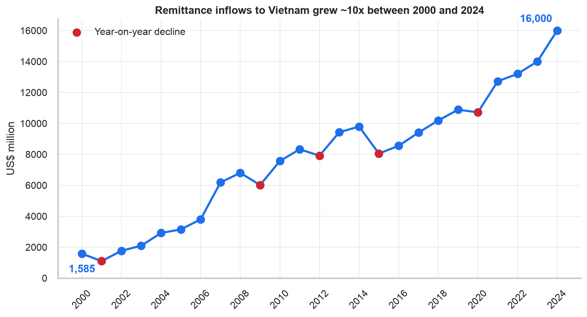
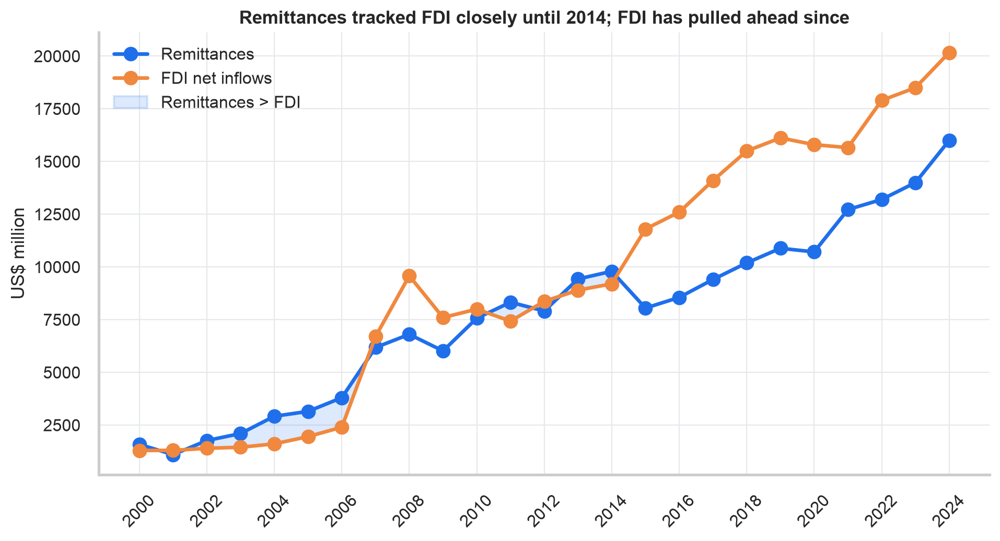
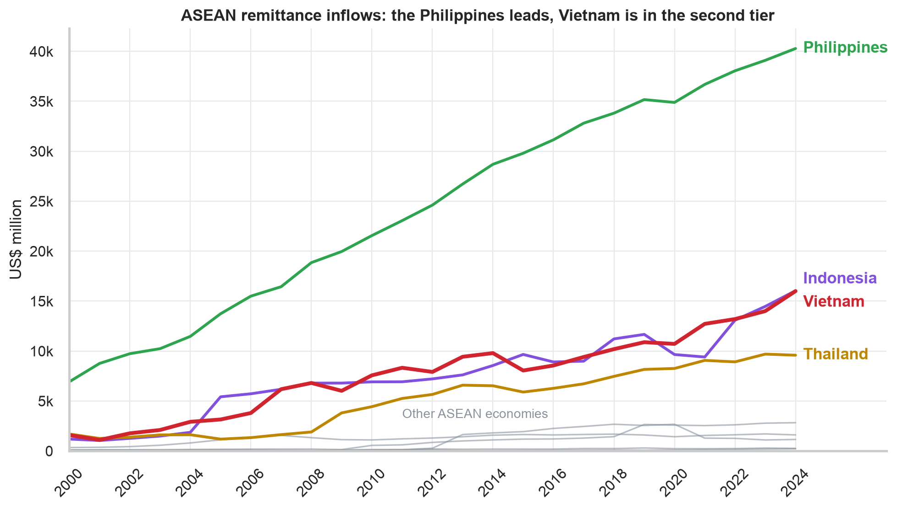
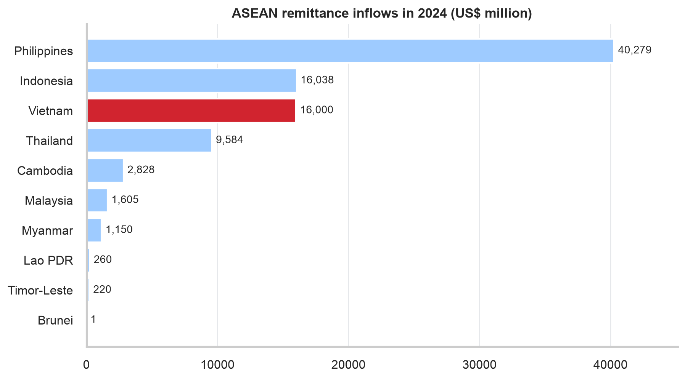
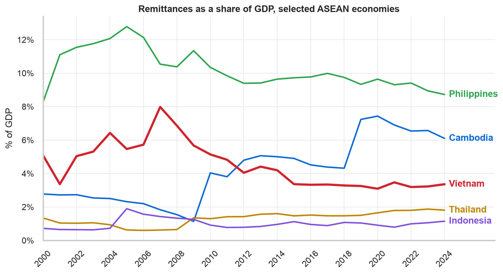
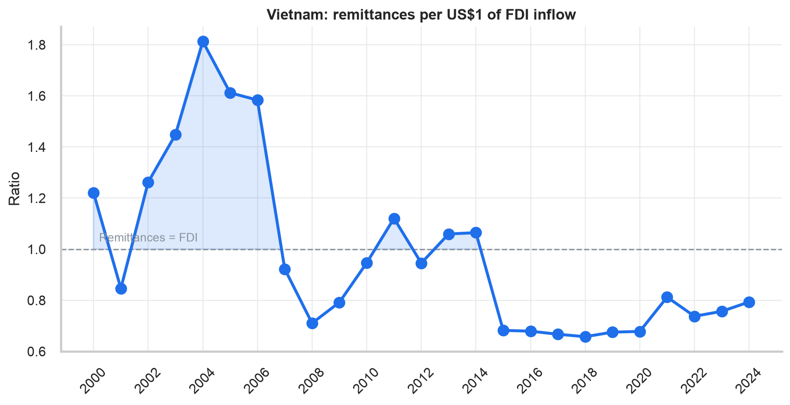

# Southeast Asia Financial Flows Analytics
### The Growing Importance of Remittances in Vietnam


> Millions of Vietnamese work abroad and send money home. **How big has that flow become, and how does it compare with foreign investment and with Vietnam's neighbours?**
> This project answers with 25 years of World Bank data (2000-2024) across all ASEAN economies.



## Key findings

| # | Question | Finding |
|---|----------|---------|
| 1 | **Growth** | Remittances rose from **US$1.6bn (2000) to US$16.0bn (2024)**: **10.1x**, a **10.1% compound annual growth rate**. Five dips (2001, 2009, 2012, 2015, 2020) were all followed by recovery. |
| 2 | **Scale vs FDI** | Remittances exceeded FDI in 9 of the 15 years to 2014. FDI has been larger since 2015, but in 2024 remittances (US$16.0bn) were still **79% of FDI** (US$20.2bn): the same order of magnitude. |
| 3 | **Regional rank** | Vietnam is **#3 in ASEAN**, level with Indonesia (US$16.04bn) and behind only the Philippines (US$40.3bn). It receives **18%** of all ASEAN remittances. |
| 4 | **Caveat (extension)** | Relative to GDP, the picture is more modest: remittances fell from a **~8% peak (2007) to a stable ~3.3%** since 2015, because the economy grew even faster (~15x). Vietnam is large in absolute terms but far less *dependent* on remittances than the Philippines (8.7%) or Cambodia (6.1%). |

**Conclusion:** remittances are a large, persistent source of external finance for Vietnam, comparable in scale to FDI and among the biggest in ASEAN, though their importance *relative to the economy* has declined as Vietnam has grown.

## Visual tour

### Scale versus FDI
Remittances tracked FDI closely until 2014; FDI has pulled ahead since.



### Vietnam within ASEAN
The Philippines leads clearly. Vietnam, Indonesia and Thailand form a second tier far above the rest.





### Beyond the headline: remittances relative to GDP


### Remittances per US$1 of FDI


## Data

| Dataset | Source | Coverage | File |
|---------|--------|----------|------|
| Inward remittance flows (US$ million) | [World Bank / KNOMAD](https://www.knomad.org/data/remittances) | 2000-2024, ~210 economies | `data/raw/inward_remittance_flows.xlsx` |
| FDI, net inflows, BoP (current US$) | [World Bank WDI](https://data.worldbank.org/indicator/BX.KLT.DINV.CD.WD) | 1960-2025 | `data/raw/fdi_net_flows.csv` |
| GDP (current US$) | [World Bank WDI](https://data.worldbank.org/indicator/NY.GDP.MKTP.CD) | 1960-2025 | `data/raw/gdp.csv` |

Processed outputs (panel, 2024 snapshot, growth table, headline stats) are in [`reports/tables/`](reports/tables).

**Data-quality notes**
- KNOMAD stores "not reported" as `0` for some economies (e.g. Singapore), so zeros are treated as missing.
- Cambodia (~2019) and Indonesia (~2005) show step changes that look like series revisions, so their growth multiples should be read with caution.
- FDI is *net* inflows and can be volatile; the comparison is about order of magnitude, not equivalence. The two flows come from different actors (households vs. firms) and play different economic roles.

## Method
1. **Clean:** reshape wide World Bank tables to a tidy country-year panel, harmonise country names via ISO codes (e.g. "Viet Nam" vs "Vietnam"), convert units to US$ million.
2. **Derive:** YoY growth, CAGR, remittances/GDP, FDI/GDP, remittances/FDI ratio, ASEAN share and rank.
3. **Visualise:** six publication-style charts with annotated key values.

## Repository structure
```
.
├── data/raw/                 # original World Bank / KNOMAD files
├── src/
│   ├── data.py               # loading + cleaning -> tidy ASEAN panel
│   ├── analysis.py           # headline stats, rankings, growth
│   └── viz.py                # all figures
├── notebooks/
│   └── vietnam_remittances_analysis.ipynb   # narrative walkthrough (executed)
├── reports/
│   ├── figures/              # PNG charts used above
│   └── tables/               # CSV / JSON outputs
├── run_pipeline.py           # rebuilds every table and figure
└── requirements.txt
```

## Reproduce it
```bash
git clone https://github.com/cookie2006-gif/Southeast-Asia-Financial-Flows-Analytics.git
cd Southeast-Asia-Financial-Flows-Analytics
python -m venv .venv && source .venv/bin/activate
pip install -r requirements.txt
python run_pipeline.py                      # regenerates reports/
jupyter lab notebooks/vietnam_remittances_analysis.ipynb
```

## Ideas for extension
- Add **population** data for per-capita remittances.
- Add **source-country** (bilateral) remittance data to see where Vietnamese migrants send money from.
- Model the **drivers** of remittances (GDP growth, exchange rate, host-country conditions) with a panel regression.
- Compare ASEAN with other regions, or add the 2025 data point once KNOMAD publishes it.

## Author
**Sy Quoc Uy Vo**, originally developed as a country project in data science.
